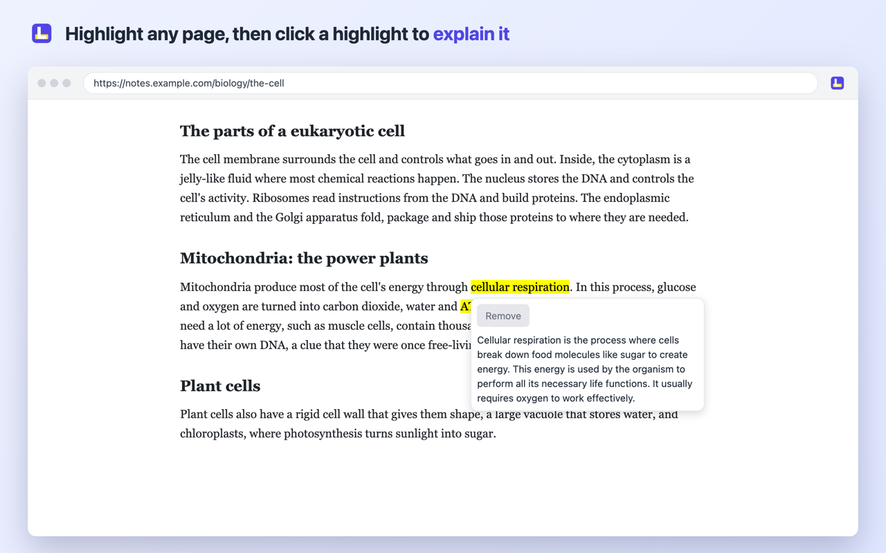
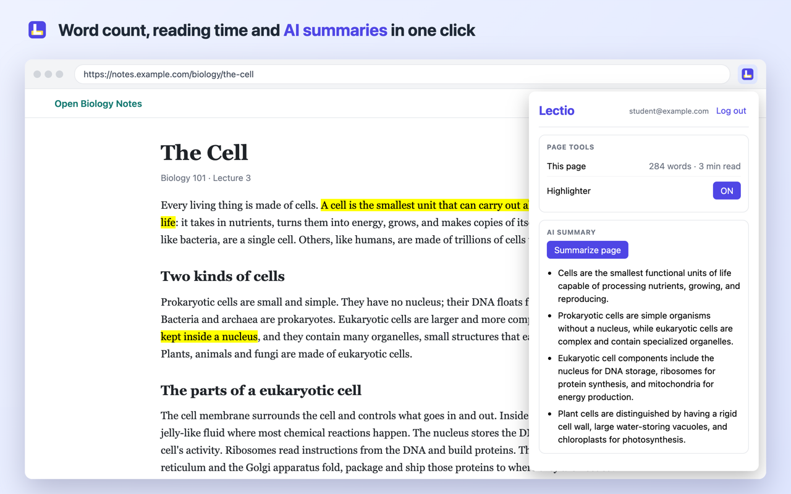
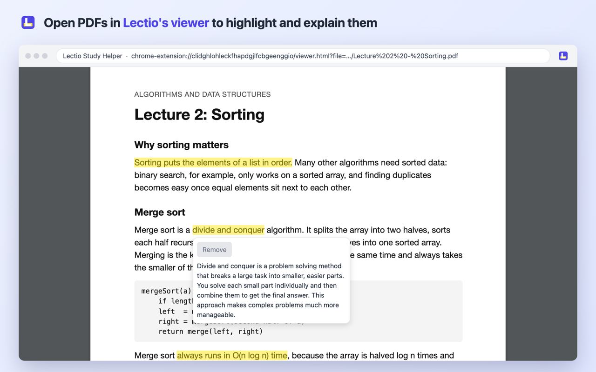

# Lectio Study Helper

A Chrome extension that helps students study web pages and PDFs: highlight important text, see the word count and reading time, and get AI summaries and explanations.

**Chrome Web Store:** coming soon (in review)

## Why I built this

I built Lectio to learn. I wanted one real project that uses HTML, CSS, JavaScript, React, Node.js, Express and PostgreSQL together, plus things I had never tried, like Chrome extensions, hosting and AI. And I wanted it to actually help other students study.

## Features

- **Highlighter:** select text on any page to highlight it. Highlights are saved in the browser and come back when you return to the page, even when they cross links, bold text or paragraphs.
- **Explain:** click a highlight to get a short AI explanation in simple words, or to remove it.
- **PDFs:** open any PDF in Lectio's own viewer to highlight and explain it.
- **Word count and reading time** for the current page or PDF.
- **AI summary** of the current page, in the page's language.
- **Accounts:** register with email verification, log in, reset a forgotten password. AI features need a free account and have a daily limit per user.

## Screenshots

Highlight any page, then click a highlight to explain it with AI or to remove it.



The popup, with the word count, reading time, the highlighter switch and an AI summary.



A lecture PDF in Lectio's own viewer, highlighted and explained.



## How it works

The extension talks to my Express server on Vercel, which keeps the accounts in PostgreSQL on Neon and calls Cloudflare Workers AI, so the AI key never leaves the server.

## Tech stack

- **Extension:** Chrome Manifest V3, React 19, Vite 8, pdf.js
- **Server:** Node.js, Express 5, PostgreSQL, bcrypt, JSON Web Tokens, Nodemailer
- **AI:** Cloudflare Workers AI (Gemma 4)
- **Hosting:** Vercel (server), Neon (database)
- **Tests:** Vitest, jsdom, Supertest

## Problems I ran into

**Changing the AI.** I started with Google's Gemini, but right before publishing I found out its free tier isn't allowed for users in the EU, so I switched to Cloudflare Workers AI. My first bug with the new AI: it explained the Romanian word "mitocondrie" in French. Now Lectio also tells it the page's language.

**Putting it online.** Everything worked on `localhost`, but only on my laptop. Now the server runs on Vercel and the database on Neon, both for free.

**Using APIs and keeping secrets private.** It was my first time using real APIs: the AI, sending emails and an online database. Each one comes with a secret key, and anyone who has it could use my accounts. So the keys stay only on the server, in a `.env` file that never goes to GitHub, and the extension only talks to my server. Passwords are saved hashed with bcrypt, never as plain text.

**Learning how Chrome works.** I had never made an extension, so I had to learn how its parts talk to each other: the popup, the script inside web pages, and a background worker. Chrome also doesn't let extensions into its PDF viewer, so I made my own with pdf.js.

**Highlights that didn't work properly.** My first highlighter broke as soon as I selected across a link. And if a word appeared 3 times on a page, the highlight always came back on the first one. Now each piece of text gets its own highlight, and Lectio remembers which copy it was.

## Known limits and what's next

- Highlights are saved only in your browser. Syncing them through your Lectio account is my plan for version 2.
- The PDF viewer draws all pages at once, so a 500-page book is slow (lecture slides are fine).
- The AI runs on a free plan with a daily limit shared by everyone, so on a busy day it may say "The AI is busy".

## Run it locally

### Extension

```bash
npm install
npm run build
```

Open `chrome://extensions`, turn on **Developer mode**, click **Load unpacked** and choose the `dist` folder.

The extension uses the online server. To use a local server, change `SERVER_URL` in `src/config.js` and `public/background.js`, and add `http://localhost:3000/*` to `host_permissions` in `public/manifest.json`.

### Server

```bash
cd server
npm install
```

Create the tables with `server/schema.sql`, then create `server/.env`:

```
DATABASE_URL=postgres://user@localhost:5432/lectio
JWT_SECRET=a long random string
SERVER_URL=http://localhost:3000
EMAIL_USER=a Gmail address
EMAIL_PASS=a Gmail App Password
CLOUDFLARE_ACCOUNT_ID=your Cloudflare account id
CLOUDFLARE_API_TOKEN=a Workers AI API token
```

Optional: `SUMMARY_DAILY_LIMIT` (default 10) and `EXPLAIN_DAILY_LIMIT` (default 30).

Start it with `node index.js` (runs on http://localhost:3000).

### Tests

```bash
npm test                # extension: 20 tests
cd server && npm test   # server: 6 tests, no database needed
```

## Privacy

Highlights stay in your browser. See the [privacy policy](https://lectio-study-helper-extension.vercel.app/privacy).

## About

Made by Marian David-Andrei, a second-year Computer Science student at Babeș-Bolyai University, Cluj-Napoca.

Lectio Study Helper is not affiliated with lectio.dk.
